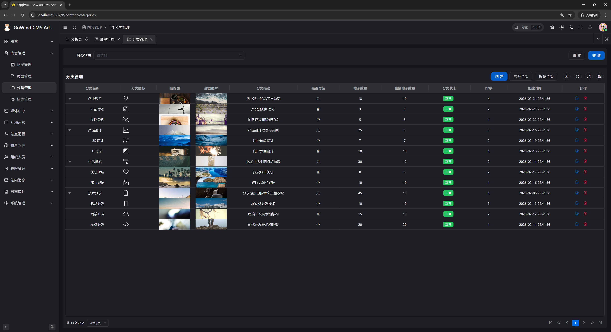
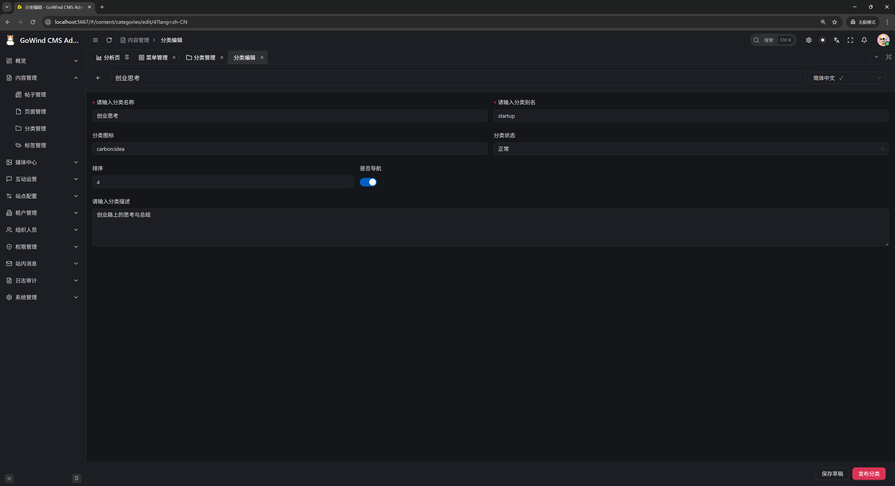

<div align="center">


# GoWind Content Hub

[](./LICENSE)
[](https://go.dev/)
[](https://vuejs.org/)
[](https://react.dev/)
[](https://flutter.dev/)
[](https://go-kratos.dev/)

**English** | [中文](./README.md) | [日本語](./README.ja-JP.md)

</div>

---

GoWind Content Hub is an out-of-the-box, enterprise-grade Golang full-stack headless content platform, providing enterprises with flexible and scalable full-domain content management and distribution solutions.

**Key Highlights:**

- **API First** — Complete RESTful / gRPC dual-protocol interfaces with auto-generated OpenAPI docs
- **Multi-platform** — Frontend support for Vue, React, Taro (Mini Program), and Flutter
- **Multi-tenant** — Tenant data isolation with auto-initialized roles and admins
- **Fine-grained Permissions** — Three-level access control: menu, API, and data permissions with button-level granularity
- **Native i18n** — Unified translation management for content, menus, and UI text
- **Microservices** — Built on go-kratos with service discovery, distributed tracing, and distributed transactions

## Demo

| Demo Type | Access URL |
|:---|:---|
| Admin Panel | [https://admin.cms.gowind.cloud](https://admin.cms.gowind.cloud) |
| Admin API Swagger | [https://api.admin.cms.gowind.cloud/docs/](https://api.admin.cms.gowind.cloud/docs/) |
| App API Swagger | [https://api.cms.gowind.cloud/docs/](https://api.cms.gowind.cloud/docs/) |
| Vue Frontend | [https://cms.gowind.cloud](https://cms.gowind.cloud) |
| React Frontend | [https://react.cms.gowind.cloud](https://react.cms.gowind.cloud) |
| Taro Frontend | [https://taro.cms.gowind.cloud](https://taro.cms.gowind.cloud) |
| Flutter Frontend | [https://flutter.cms.gowind.cloud](https://flutter.cms.gowind.cloud) |

> Default credentials for all demo sites: `admin` / `admin`

## Tech Stack

### Backend

| Layer | Technology | Description |
|:---|:---|:---|
| Language | [Go 1.25+](https://go.dev/) | High-performance compiled language |
| Framework | [go-kratos](https://go-kratos.dev/) | Microservice framework by Bilibili |
| DI | Hand-written assembly (`wiring.go`) | No DI framework; `make register` assists module registration |
| ORM | [Ent](https://entgo.io/) | Go entity framework |
| Database | [PostgreSQL](https://www.postgresql.org/) / [MySQL](https://www.mysql.com/) | Relational database |
| Cache | [Redis](https://redis.io/) | In-memory data store |
| Object Storage | [MinIO](https://min.io/) | S3-compatible object storage |
| Search Engine | [OpenSearch](https://opensearch.org/) | Full-text search |
| Service Registry | [Etcd](https://etcd.io/) / [Consul](https://www.consul.io/) | Service discovery & configuration |
| Tracing | [Jaeger](https://www.jaegertracing.io/) + [OpenTelemetry](https://opentelemetry.io/) | Distributed observability |
| API Definition | [Protobuf](https://protobuf.dev/) + [buf.build](https://buf.build/) | Contract-first API design |
| AuthZ Engine | [Casbin](https://casbin.org/) / [OPA](https://www.openpolicyagent.org/) | Policy-driven authorization |

### Admin Frontend

| Technology | Description |
|:---|:---|
| [React 19](https://react.dev/) | Progressive frontend framework |
| [TypeScript](https://www.typescriptlang.org/) | Type-safe development |
| [Ant Design](https://ant.design/) | Enterprise UI component library |
| [ProComponents](https://procomponents.ant.design/) | Enterprise middle/back-office components |

### App Frontend

**Two kinds of "frontends" first**: this project ships two kinds of user-facing interfaces. The **admin console** serves your operations team — opened in a desktop browser to write posts, moderate comments and configure sites. The **app frontends** below serve your readers and customers — they consume the content you publish. There is exactly one backend; once content is published, all four frontends read the same data. **Pick the one (or ones) that matches where your audience is — no need to deploy them all.**

| Version | Tech Stack | Where It Runs | Typical Use |
|:---|:---|:---|:---|
| Vue | [Nuxt.js](https://nuxt.com/) + [shadcn-vue](https://www.shadcn-vue.com/) | Desktop / mobile **browser (web page)** | Corporate sites, content portals, blogs, news sites; SEO-friendly |
| React | [Next.js](https://nextjs.org/) + [shadcn/ui](https://ui.shadcn.com/) | Desktop / mobile **browser (web page)** | Feature-equal to the Vue version — pick whichever stack your team prefers |
| Taro | [Taro](https://docs.taro.zone/en/docs/) + React + [shadcn/ui](https://ui.shadcn.com/) | **WeChat Mini Program**; also compiles to mobile H5 web | WeChat-ecosystem operations: scan or search to open, no installation |
| Flutter | [Flutter](https://flutter.dev/) + [BLoC](https://bloclibrary.dev/) | **iOS / Android native app** (installed from app stores) | A dedicated app: push notifications, offline use; one codebase builds both platforms |

#### Glossary (for readers new to frontends)

- **Web page**: opened in a browser by typing a URL — works on desktop and mobile, nothing to install. The React and Vue versions fall into this category, and both support **SSR** (server-side rendering: pages are assembled on the server before being sent to the browser, so search engines index them more easily — good for **SEO**).
- **H5**: the mobile web page opened inside WeChat or a mobile browser. Still a web page at heart — no installation, opens on tap.
- **WeChat Mini Program**: a lightweight app that runs *inside* WeChat. Users open it by scanning a QR code or searching within WeChat — nothing to download and nothing on the home screen. It is the most common reach channel in the WeChat ecosystem (official-account funnels, group sharing, offline QR codes).
- **Native app**: a program downloaded from the App Store / Android app stores and installed on the phone's home screen. Smoothest experience, with access to device capabilities such as push notifications, camera and offline storage. Flutter's value: **one codebase produces both the iOS and the Android app**.

#### Which one should I choose?

- Readers reach you via a browser (official site / portal / blog) → pick **React** or **Vue**; they are feature-equal, so choose by your team's stack.
- Your audience lives in WeChat (official account, group sharing, offline QR codes) → pick **Taro** (WeChat Mini Program).
- You need your own app in the app stores, or push notifications / device capabilities → pick **Flutter**.
- Combos are supported: e.g. React for the website + Taro for the Mini Program — both consume the same content and configuration, with no duplicate entry.

## Core Features

### Organization & Permissions

| Feature | Description |
|:---|:---|
| Multi-tenant Management | Tenant creation, enable/disable, package config & data isolation; auto-init roles & admin |
| User Management | Full lifecycle management, multi-role/dept binding, advanced queries |
| Role Management | Role & role group management with fine-grained menu, API & data permissions |
| Permission Management | Permission groups, menu nodes & permission points with button-level control |
| Menu Management | Visual menu config with directory/page/button levels, dynamic rendering by permission |
| OpenAPI Credentials | Tenant-level AK/SK machine credentials, token exchange issuing short-lived JWTs, IP+AK brute-force rate limiting |
| Tenant Quotas | User/storage/API call/AI token quotas per tenant, hard gates + watermark alerts, self-service usage panel |
| Login Policy | Four-dimension blacklist/whitelist (IP/time/device/region), global + targeted two-stage enforcement; expired-password login denial |
| Department Management | Multi-level department tree management with user binding |

### Content & Site

| Feature | Description |
|:---|:---|
| Content Modeling | Visual custom content models with text, number, rich text, image, file, relation fields |
| Content Management | CRUD, publish/unpublish, pin, sort, recycle bin & batch operations; rich text / Markdown |
| Category Management | Multi-level category tree, content model binding, frontend filtering |
| Tag Management | Tag CRUD with content association, search & aggregation |
| Comment Management | Comment audit, delete, reply, block; filter by content, user, time |
| Multi-language Management | Language management, unified translation for content, menus & UI text |
| Site Management | Multi-site config with independent domain, title, logo, SEO & style |
| Site Configuration | Basic info, SEO, upload limits, email/SMS global params |
| Page Builder | Section-based page editor (rich text / gallery / form etc., 14 block types), rendered on all three frontends |
| Review Workflow | Post submit-for-review → approve/reject with author notifications; permission gate via API role binding |
| Content Experiments | A/B random splits and audience targeting (locale/device/login/params), full-page variant replacement, participant stats |
| Collaborative Edit Locks | Holder banner on post/page editors (Redis soft lock with heartbeat); prevents blind concurrent overwrites |
| Realtime Co-editing | Live conflict-free merging and shared cursors for rich text (embedded ygo engine, per-content+language rooms); saving stays explicit |
| Content Versioning | Automatic full snapshots on save, version list, line diff vs current, one-click restore |
| Draft Preview | One-click new-tab draft preview from the editor (short-lived signed tokens) |
| Redirect Management | 301/302 redirect rules, nginx map export, public lookup endpoint for SSR middleware |
| Form Submissions | Visitor submissions from page FORM sections; admin list, detail & CSV export |

### System & Operations

| Feature | Description |
|:---|:---|
| File Management | Image/document/video management, local or OSS storage, preview, download, grouping |
| Dictionary Management | Data dictionary categories & items, linked queries, sorting, import/export |
| API Management | Backend API maintenance & auto-sync, tree view, request/response config |
| Task Scheduling | Cron job management, start/pause/execute, execution history & logs |
| Message Notification | Multi-level message categories, targeted messaging, read status tracking |
| Internal Messages | Personal inbox, view/delete, single/batch mark as read |
| Login Logs | Login success/failure logs with account, IP, location, device, time |
| Operation Logs | Full-link audit trail with operator, IP, params & results |
| Personal Center | Profile editing, avatar, password reset, login history |
| Headless API | Complete OpenAPI for content CRUD, multi-terminal support; plus a read-only GraphQL content API (posts/pages/categories/tags on `:6702`) |
| Webhook Events | Content events (publish/update/delete) delivered asynchronously with HMAC signatures; delivery log & test ping |
| Email Outbound | System notifications via async SMTP; visual SMTP configuration (credentials encrypted) + test send |
| API Sync | OpenAPI reconciliation sync for the API table (safe on non-empty tables, stable IDs protect role bindings) |
| Backup & Restore | One-click async backup of 24 core identity/permission/org tables (MinIO bucket + project prefix isolation), empty-database restore preserving IDs, bucket lifecycle cleanup |
| System Params | Platform-global dynamic KV config, visual params page, in-process cache + Redis multi-instance invalidation broadcast; built-in password policy thresholds |
| Online Sessions | Full online session list & force logout, filter by username/IP |
| Server Monitor | Go runtime / DB connection pool / host info read-only dashboard (10s auto-refresh) |
| Redis Cache Monitor | INFO section tree, DBSIZE & slow-log read-only panel |

### Social Distribution

| Feature | Description |
|:---|:---|
| Social Accounts | Connect 10 platforms — Bluesky / Mastodon / DEV.to / Telegram / WordPress / WeChat Official Account / Nostr / Weibo / LinkedIn / cnblogs via MetaWeblog (most review-free); credentials verified on save, AES-GCM encrypted, only masked hints on read |
| Content Distribution | Per-platform text & title overrides, scheduled or instant publishing; full state-machine tracking with one-click retry |
| Publishing Calendar | Calendar/list dual view, monthly schedule overview, click a date to schedule quickly |
| Engagement Stats | Platform likes/replies/reposts snapshots, instant manual refresh + periodic auto-sync |

### AI Assistant

| Feature | Description |
|:--------|:------------|
| Model Providers | OpenAI-compatible endpoint management (cloud API / local Ollama), encrypted API keys, usage metering |
| Chat Assistant | SSE streaming chat with CMS read-only tools (content overview / post query / comment stats) |
| Knowledge Base RAG | Documents (txt/md/docx/pdf) auto-chunked & vectorized into pgvector, retrieved into chat context |
| AI Query | Natural language → read-only SQL → structured results, table whitelist & tenant fail-closed |
| Semantic Content Search | Post titles/summaries vectorized into global search (Ctrl+K), incremental & full rebuild |
| Safety Insights | Dashboard rule-based 24h audit anomaly scan with LLM summary (platform admins) |
| AI Content Generation | One-click generation for post title/summary/body, page titles, category/tag descriptions, comment replies, role descriptions |
| Usage Stats | Full call metering (chat/generation/embedding), monthly summary & server-side export |
| AI Agent Orchestration | Visual canvas orchestration of five node types (start/knowledge/LLM/condition/end), synchronous trial runs with per-node trace + SSE live trajectory, run ledger & usage metering |

## Project Structure

```
go-wind-cms/
├── backend/                        # Backend services
│   ├── api/                        # Protobuf API definitions & generated code
│   │   ├── protos/                 # .proto source files
│   │   └── gen/                    # Generated code (Go / TypeScript / OpenAPI)
│   ├── app/
│   │   ├── admin/service/          # Admin service (HTTP/gRPC)
│   │   ├── app/service/            # App service (HTTP/gRPC)
│   │   └── core/service/           # Core service (business logic + data layer)
│   ├── pkg/                        # Shared packages (auth/crypto/eventbus/JWT/middleware/OSS...)
│   └── scripts/                    # Deploy scripts (Docker/PM2/env setup)
├── frontend/
│   ├── admin/                      # Admin frontend (React 19 + Ant Design 6 + ProComponents)
│   └── app/                        # App frontends
│       ├── react/                  # React app (Next.js)
│       ├── vue/                    # Vue app (Nuxt.js)
│       ├── taro/                   # Taro app (WeChat Mini Program / H5)
│       └── flutter_app/            # Flutter app (cross-platform native)
└── docs/                           # Documentation & screenshots
```

## Quick Start

### Prerequisites

- Go 1.25+
- Docker & Docker Compose
- Node.js 18+ & pnpm
- buf (Protobuf toolchain)

### 1. Start Dependencies

```bash
cd backend

# Windows
.\scripts\docker\libs_only.ps1

# Linux / macOS
./scripts/docker/libs_only.sh
```

### 2. Start Backend

```bash
# Recommended: use gow CLI
gow run admin

# Or debug directly in your IDE
```

### 3. Start Frontend

```bash
# Admin panel
cd frontend/admin
pnpm install
pnpm dev

# React app
cd frontend/app/react
pnpm install
pnpm dev
```

### Common Commands

```bash
cd backend

# Generate Protobuf API code
make api

# Generate OpenAPI docs
make openapi

# Generate TypeScript code
make ts

# Generate all code (ent + api + openapi)
make gen

# Build all services
make build

# Run tests
make test
```

> For more development workflows, see [Backend Docs](./backend/README.md) and [Scripts Guide](./backend/scripts/WORKFLOWS_AND_BEST_PRACTICES.md).

## Backend Screenshots

<table>
    <tr>
        <td></td>
        <td></td>
    </tr>
    <tr>
        <td></td>
        <td></td>
    </tr>
    <tr>
        <td></td>
        <td></td>
    </tr>
    <tr>
        <td></td>
        <td></td>
    </tr>
    <tr>
        <td></td>
        <td></td>
    </tr>
    <tr>
        <td></td>
        <td></td>
    </tr>
    <tr>
        <td></td>
        <td></td>
    </tr>
</table>

## Frontend Screenshots

<table>
    <tr>
        <td></td>
        <td></td>
    </tr>
    <tr>
        <td></td>
        <td></td>
    </tr>
    <tr>
        <td></td>
        <td></td>
    </tr>
    <tr>
        <td></td>
        <td></td>
    </tr>
    <tr>
        <td></td>
        <td></td>
    </tr>
</table>

## Contact

- WeChat: `yang_lin_bo` (Note: `go-wind-cms`)
- Juejin Column: [go-wind-cms](https://juejin.cn/column/7541283508041826367)

## Contributing

We welcome all forms of contribution, including but not limited to:

- Submit [Issues](../../issues) to report bugs or suggest features
- Submit [Pull Requests](../../pulls) to fix issues or add features
- Improve documentation and translations
- Share your experience

## License

This project is licensed under the [MIT License](./LICENSE).

## Acknowledgements

[](https://jb.gg/OpenSource)

Thanks to [JetBrains](https://jb.gg/OpenSource) for providing free GoLand & WebStorm open source licenses.
